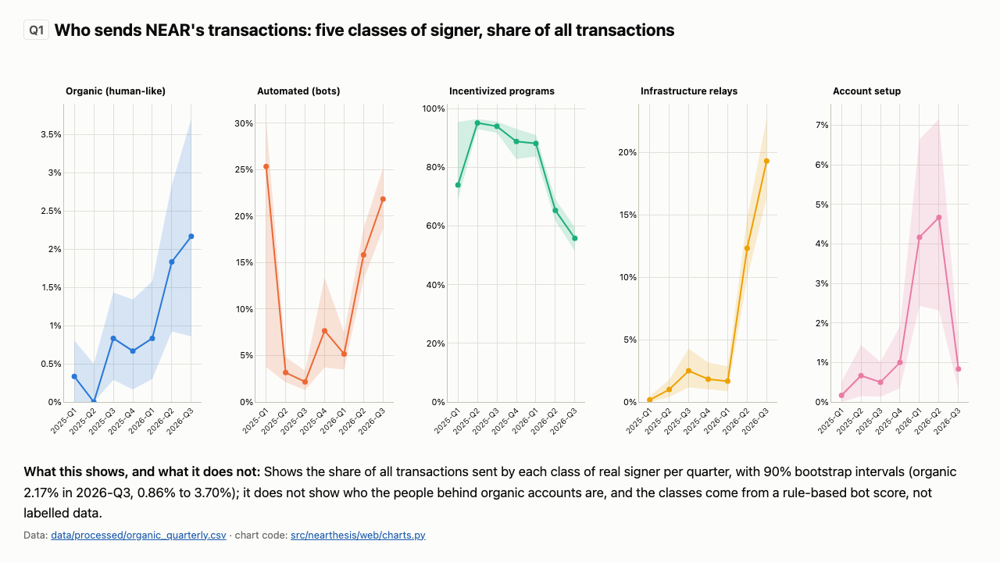

# near-thesis: NEAR on the evidence

A data-backed, re-runnable long-term thesis on NEAR for the NEAR HACKATHON 2026, track `thesis` ("judged on the
evidence, not the conviction"). Keyless public data, committed snapshots, one command to rebuild every number, chart
and sentence that quotes a number. Not financial advice.

- **Thesis**: [`thesis/THESIS.md`](thesis/THESIS.md) (every number is filled in from `data/processed/` by the build;
  the table behind each one is in [`thesis/NUMBERS.md`](thesis/NUMBERS.md))
- **Dashboard**: https://soldanoandrea.github.io/near-thesis/ once GitHub Pages is enabled for the public repository;
  locally, open [`site/index.html`](site/index.html) (the thesis) and [`site/dashboard.html`](site/dashboard.html) (charts,
  falsifier scorecard, data provenance) straight from disk, no server needed
- **Predictions**: [`thesis/predictions.csv`](thesis/predictions.csv), frozen on 2026-10-31, sha256 in the annotated git
  tag `predictions-2026-10-31`; how each is checked in [`thesis/falsifiers.md`](thesis/falsifiers.md)
- **Video** (under 3 minutes, silent, headings on screen): [`docs/media/demo.mp4`](docs/media/demo.mp4), storyline in
  [`docs/DEMO_SCRIPT.md`](docs/DEMO_SCRIPT.md); dashboard screenshots in [`docs/media/screens/`](docs/media/screens)



## What the thesis finds

<!-- findings:start (generated by `make site` from thesis/findings.in.md; do not edit) -->
- **Organic use is about 2% of NEAR's transactions.** Human-like signers sent 2.17% of transactions in
  2026-Q3 (90% interval 0.86% to 3.70%); organic daily active signers were 6,437
  (1,935 to 12,045) against 23,402 in 2025-Q1, a trend of -37.83% a
  year that barely beats a random walk out of sample. NearBlocks' "active accounts" undercount real signers
  5.2x, because relayed transactions hide the user behind the relayer.
- **NEAR Intents is real, its revenue checks out, its volume looks two-sided.** Public on-chain swaps counted once add up
  to 46.04% of DefiLlama's volume on 6 sampled days (92.08% counting
  both legs); captured revenue rebuilt from the revenue wallets is 98.68% of DefiLlama's.
- **Holders are still diluted.** 3.11M NEAR has been bought back and held since 2026-02-23, yet
  the float grows 2.12% a year at the 2.5% cap; offsetting that needs
  8.1x today's Intents revenue (5.1x under HSP-029, in vote at the
  snapshot). Stakers gain 2.51% a year in share of the float; non-stakers lose 2.06%.
- **The valuation depends on whether Intents counts.** NEAR's market cap is 2,516x its annualized chain fees
  (peer median 379x) but 80.0x counting Intents fees.
  Developers fell 36.24% in a year to 563 monthly actives, less than the peer chains did.
- **The treasury moved 30.17M NEAR in April-May 2026**; 20.95M NEAR of it reached
  the p2p-org and figment staking pools within five hops, the rest ends at unlabelled accounts. Verdict: a conditional
  case, not a bullish one. 3 of 10 pre-registered falsifiers are met, and
  7 dated predictions are frozen (sha256 `a926c6a50937ad55d4e5b9e00cf66aa33d86fda8a9c906b1c37fdf2a30b60c94`, git tag `predictions-2026-10-31`).
<!-- findings:end -->

## Reproduce in two commands

Requirements: macOS or Linux, `make`, and [uv](https://docs.astral.sh/uv/) (`curl -LsSf https://astral.sh/uv/install.sh | sh`).
uv installs Python 3.12 and the locked dependencies itself; the build and the tests never touch the network (viewing the
charts in a browser loads the pinned Plotly.js from cdnjs).

```
git clone https://github.com/soldanoandrea/near-thesis && cd near-thesis
make reproduce
```

You should see two "Key results" tables, `[build] as-of 2026-10-29; wrote 61 files ...`, `[site] wrote ... files (... kB in site/)`
and pytest ending in `passed` (one test is skipped if your clone does not have the tag `predictions-2026-10-31`). Then `git status` shows nothing modified: every processed table,
report, the essay and the site are byte-identical to the committed ones. Open `site/index.html` in a browser. The
step-by-step table for automated screeners is [below](#reproduce-for-automated-screeners-do-x-see-y).

## Judging map

| Criterion | Where it is demonstrated |
|---|---|
| Reproducibility (screening) | `make reproduce` (offline, about one minute after setup); [`data/raw/MANIFEST.json`](data/raw/MANIFEST.json) (URL, parameters, fetch time, sha256 of every snapshot); `tests/` (manifest, schemas, gaps, sanity ranges, cross-source agreement, determinism of every output including the essay and the site); [`docs/FRESH_CLONE_CHECK.md`](docs/FRESH_CLONE_CHECK.md) |
| Technical implementation | keyless stratified block sampling and per-signer histories with a bot score and bootstrap intervals ([`transform/organic.py`](src/nearthesis/transform/organic.py)); NEAR Intents volume rebuilt from DIP-4 events with a fee-collector census ([`transform/intents_check.py`](src/nearthesis/transform/intents_check.py)); revenue, buyback and treasury ledgers with five-hop trails ([`transform/ledgers.py`](src/nearthesis/transform/ledgers.py)); exact yoctoNEAR supply identity from archival headers ([`transform/supply.py`](src/nearthesis/transform/supply.py)); four tested models ([`models/`](src/nearthesis/models)) |
| Design | [`site/dashboard.html`](site/dashboard.html): eight charts, each with a one-sentence "what this shows, and what it does not", its source tables and a data table; light and dark themes; phone widths; no build step |
| Impact | findings that change how NEAR's public metrics should be read (NearBlocks undercounts real signers, DefiLlama's Intents volume is about two-sided, captured revenue is verifiable, where the 2026 treasury outflows went), and a keyless pipeline anyone can re-run on the next snapshot |
| Originality | a bot-vs-human decomposition with intervals and no BigQuery; an independent on-chain check of a NEAR-uploaded aggregate; pre-registered falsifiers and hashed predictions; an essay whose numbers are filled in by the build, so prose cannot drift from data |
| Sustainability | `make refresh` re-downloads every source (keyless, rate limited); [`thesis/predictions.csv`](thesis/predictions.csv) is checkable on 2027-04-30 and 2027-10-31 with the commands in [`thesis/falsifiers.md`](thesis/falsifiers.md); Pages workflow; MIT |

## Other submission by the same team

**Allowance**: a sandboxed treasury for AI agents on NEAR (tracks `security`, `agents`, `business`).
Repository: https://github.com/soldanoandrea/allowance

## Timeline

NEAR HACKATHON was announced on 2026-10-19. Per HACKATHON.md Q-001, code written from the announcement onward counts;
only commits before it would be a baseline. This repository has no baseline: **every commit is dated 2026-10-30 or
later** (the first, `440cb6e`, on 2026-10-30), the plan in `PIANO.md` was written on 2026-10-30, and the repository
contains no pre-existing code; the only code not written for this project is the public libraries listed under
[Disclosure](#disclosure). Check it with `git log --reverse --format='%ad %h %s' --date=short | head -3`.

## Disclosure

**AI-generated code.** All code, tests, documentation, the essay and the site in this repository were written by AI
coding agents, Claude models by Anthropic (Claude Opus 5.5 and Claude Fable 5.1) working in Claude Code,
under the direction of the human owner of the project, who reviewed them by running the pipeline and the tests. Commits
written by an agent carry a `Co-Authored-By: Claude ...` trailer. `PIANO.md` (the plan) was written with AI assistance.
The numbers are not AI-generated: they are computed by the code from the committed public-API snapshots, and the essay's
numbers are filled in by `make site`. The subjective weights in [`thesis/valuation_priors.toml`](thesis/valuation_priors.toml)
and the priors in [`thesis/priors.md`](thesis/priors.md) are opinions, labelled as such.

**Third-party libraries, services and tools**

| Where | Library / tool | Version | License |
|---|---|---|---|
| runtime | httpx, httpcore, h11, anyio, idna, certifi, typing-extensions | 0.28.1, 1.0.9, 0.16.0, 4.15.1, 3.20, 2026.10.23, 4.16.0 | BSD-3-Clause, BSD-3-Clause, MIT, MIT, BSD-3-Clause, MPL-2.0, PSF-2.0 |
| runtime | tenacity (retries) | 9.2.1 | Apache-2.0 |
| runtime | polars, polars-runtime-32 (tables) | 2.1.0 | MIT |
| runtime | numpy (bootstrap, models) | 2.5.4 | BSD-3-Clause (with 0BSD, MIT, Zlib, CC0-1.0 parts) |
| tests | pytest, pluggy, iniconfig, packaging, pygments, colorama (Windows only) | 9.2.0, 1.7.0, 2.3.1, 26.3, 2.21.0, 0.4.6 | MIT, MIT, MIT, Apache-2.0 OR BSD-2-Clause, BSD-2-Clause, BSD-3-Clause |
| build | hatchling (PEP 517 backend, resolved by uv at build time), Python | latest at install, 3.12 | MIT, PSF-2.0 |
| site (browser) | Plotly.js, loaded from cdnjs with a subresource-integrity hash | 2.35.3 | MIT |
| hosting | GitHub Actions `actions/checkout`, `actions/configure-pages`, `actions/upload-pages-artifact`, `actions/deploy-pages` | v4, v5, v3, v4 | MIT |
| demo video only (not needed to reproduce) | VHS (with ttyd), ffmpeg, Google Chrome headless (screenshots) | 0.12.1 (ttyd 1.7.7), 9.0.2, 156 | MIT, MIT, LGPL-2.1+/GPL-2.0+ (build dependent), proprietary (Chromium BSD-3-Clause) |
| data (keyless public APIs) | NearBlocks, DefiLlama, CoinGecko, FastNear (RPC, archival RPC, indexer, API), Aurora Blockscout, GitHub REST, Electric Capital Open Dev Data, NEAR Intents 1Click token list, gov.near.org | snapshots of 2026-10-30/31 | per provider terms; Open Dev Data CC BY 4.0; attribution below |

Exact Python versions are pinned in `uv.lock`; the Python standard library (`tomllib`, `json`, `hashlib`, `fcntl`, `html`)
covers the rest, including the Markdown renderer and the site generator (`src/nearthesis/web/`).

## Reproduce (for automated screeners): do X, see Y

| Step | Do | See |
|---|---|---|
| 1 | `git clone https://github.com/soldanoandrea/near-thesis && cd near-thesis` | `README.md`, `PIANO.md`, `data/raw/MANIFEST.json`, `Makefile` |
| 2 | `make setup` | `uv sync --frozen` creates `.venv/` from `uv.lock` (the only step that uses the network: PyPI) |
| 3 | `make reproduce` | Two "Key results" tables (first pass, then phase 2a), `[build] as-of 2026-10-29; wrote 61 files ...`, `[site] wrote ... files (... kB in site/)`, then pytest ending in `passed` |
| 4 | open `site/index.html` and `site/dashboard.html` (file://, no server) | the essay; eight charts with captions and data tables, the falsifier scorecard, the dated predictions, the provenance of every raw file |
| 5 | read `thesis/THESIS.md`, `reports/analysis_summary.md`, `reports/models_summary.md`, `reports/metrics_summary.md` | the argument, then every number per question (Q1-Q7) and per model with window, source, evidence grade and, where sampled, a 90% interval |
| 6 | `git status` | nothing modified: `data/processed/*.csv`, the reports, `thesis/THESIS.md`, `thesis/NUMBERS.md`, `thesis/falsifiers.md`, `site/` and this README's findings block are byte-identical to the committed ones |
| 7 (optional) | `make verify` | `[verify] OK`: every raw file matches its sha256 in the manifest |
| 8 (optional) | `shasum -a 256 thesis/predictions.csv`; in a clone that has the tag, `git tag -n9 predictions-2026-10-31` | the hash quoted in `thesis/THESIS.md` and in the tag message |
| 9 (optional, online) | `make refresh` | re-downloads every snapshot from the public APIs (several hours because of polite rate limits), rewrites the manifest, rebuilds |

`scripts/fresh_clone_check.sh` runs steps 1-6 in a temporary clone. `uv run python scripts/probe_sources.py` prints a
one-request-per-source status table. `make video` re-renders the demo video (needs VHS, ffmpeg, Chrome and the
network for Plotly.js).

## What is in the repo

```
README.md, PIANO.md      this file; the plan (sources, questions Q1-Q8, falsifiers, risks), written before the data
thesis/                  THESIS.in.md (essay template) -> THESIS.md + NUMBERS.md (generated); findings.in.md (README block);
                         predictions.csv (frozen), falsifiers.md (generated), priors.md, valuation_priors.toml (opinions)
site/                    generated static site: index.html (essay), dashboard.html, assets/ (style.css, app.js, data.js)
config/sources.toml      endpoints, per-host rate limits, peer chains, sampling and model parameters (seeded)
src/nearthesis/
  http.py                polite client: per-host minimum interval, retries (tenacity), immutable-response cache
  manifest.py            MANIFEST.json writer (url, params, fetched_at_utc, rows, sha256)
  fetch/                 one module per source (network, used by `make refresh` only)
  transform/             raw -> tidy tables (daily long table, epoch supply accounting, activity decomposition,
                         organic.py bot score and cohorts, intents_check.py, ledgers.py, devactivity.py)
  sampling.py            signer draw design shared by the fetcher and the analysis
  models/                pure-function models: supply.py, multiples.py, adoption.py, yields.py
  metrics.py, report.py, pipeline.py   first-pass metrics, reports/metrics_summary.md, the offline build
  phase2.py, report2.py, predictions.py   analysis and model tables, the two phase-2a reports, the predictions
  web/                   `make site`: numbers.py (registry of every printed number and its source), charts.py
                         (Plotly specs), md.py (Markdown renderer), build.py (pages), static/ (CSS, JS)
data/raw/                committed snapshots (CSV) + MANIFEST.json
data/processed/          rebuilt by `make reproduce` (CSV, committed so they can be inspected without running anything)
reports/                 generated reports (metrics, analysis, models)
tests/                   manifest integrity, schemas, no-gap checks, sanity ranges, cross-source agreement, models,
                         determinism of every output, site and thesis checks
docs/                    DATA_NOTES.md (per-source quirks, the "active users" table, unverified items), DEMO_SCRIPT.md,
                         DEMO_POST.md, SUBMISSION.md, FRESH_CLONE_CHECK.md, demo.tape, media/
scripts/                 source probe, fresh-clone check, video/ (screenshots and the demo video)
.github/workflows/       pages.yml (publishes site/ to GitHub Pages on push to main)
```

Key processed tables:

| File | Grain | Content |
|---|---|---|
| `daily_long.csv` | date x chain x metric x source | every daily series (NEAR, Solana, Sui, Aptos, Base, Ethereum, Tron, Aurora), explicit units, no filling |
| `near_daily_wide.csv` | date | the NEAR rows of `daily_long.csv`, one column per metric__source |
| `series_coverage.csv` | series | span, missing days, nulls, longest gap |
| `epochs.csv` | sampled epoch | exact mint, burn, net issuance, annualized rates, realized/cap, staking ratio, validators, Nakamoto coefficient, per-block supply identity |
| `burn_vs_fees_epochs.csv` | sampled epoch | exact burn vs NearBlocks fees prorated to the epoch window |
| `activity_monthly.csv` | month | NearBlocks totals, exact census of txs to 9 contracts grouped as incentivized (HOT, KaiChing, SWEAT, NEARCrowd, inscriptions) and infrastructure (Aurora, Chain Signatures, Intents), sample shares with 90% CIs, organic proxy |
| `activity_quarterly_sample.csv` | quarter | stratified sample shares (relayed, implicit signers, ...) with bootstrap 90% CIs |
| `peers_snapshot.csv` | chain | TVL, stablecoins, fees, DEX volume, market cap, price-normalized ratios, YoY |
| `ratios_daily.csv` | date x chain x ratio | fees/market cap, TVL/market cap, stablecoins/market cap, DEX volume/TVL |
| `metrics_first_pass.csv` | metric | every headline number with window, source and evidence grade |
| `organic_monthly.csv`, `organic_quarterly.csv` | month / quarter | organic, automated, incentivized and infrastructure shares of transactions; organic transactions per day; organic and total monthly / daily active signers; 90% bootstrap intervals |
| `organic_cohorts.csv`, `organic_sensitivity.csv`, `organic_features.csv`, `organic_draws.csv` | cohort / quarter / signer-month / draw | new-signer retention at +1/+3/+6 months, threshold sensitivity, per-signer features and bot score, labelled draws |
| `intents_check_days.csv` (+ `_tx_values`, `_tokens`, `_concentration`, `_hhi`) | sampled day | on-chain swap volume (sample and fee-census estimates, 90% CI) vs DefiLlama, netting and rounding factors, asset concentration |
| `ledger_*.csv` | wallet x month / day | revenue / buyback / treasury ledgers by counterparty class, DefiLlama revenue rebuilt on-chain, treasury reward reconciliation, treasury outflow trails |
| `dev_*.csv` | repo x month / ecosystem x month | GitHub commits and authors, releases, Electric Capital monthly active developers and shares |
| `model_*.csv` | scenario / chain / series | model inputs and outputs (supply paths and scenarios, net-zero grid, multiples, adoption fits, backtests and forecasts, yields) |
| `metrics_phase2.csv` | metric | phase 2a headline numbers with window, source, grade and 90% intervals |

## Data provenance

Grades: **A** = on-chain, re-runnable from chain data; **B** = aggregator or undocumented endpoint (snapshotted).
Row counts, URLs, parameters and fetch times are in `data/raw/MANIFEST.json`.

| Raw folder | Source (PIANO.md #) | Endpoints | Key? | Limit we respect | Grade | Feeds |
|---|---|---|---|---|---|---|
| `nearblocks/` | NearBlocks (#7) | `/v1/charts`, `/v1/stats` | none | 6 req/min (we wait 11 s), 2 requests per refresh | B | daily txs, active/new accounts, supply, fees, price |
| `defillama/` | DefiLlama (#12) | `historicalChainTvl`, `summary/fees/<chain>`, `overview/dexs/<chain>`, `stablecoincharts`, `summary/{dexs,fees}/near-intents`, `coins.llama.fi/chart`, `v2/chains` | none | 1 req/s | B | TVL, chain fees/revenue, DEX volume, stablecoins, Intents, full price history |
| `coingecko/` | CoinGecko public (#13) | `/coins/<id>/market_chart?days=365` | none | 1 req / 7 s | B | market caps (365 days) |
| `aurora/` | Aurora Blockscout (#19) | `stats-service/api/v1/lines/*`, `/api/v2/stats` | none | 1 req/s | B | Aurora txs, active accounts, fees |
| `rpc/` | NEAR RPC (#1, #20-#22) | `EXPERIMENTAL_genesis_config`, `EXPERIMENTAL_protocol_config`, `validators`, `block`, `view_account`, `sputnik-dao.near get_dao_list` | none | 1 req/s | A | current stake, validators, protocol config, treasury balances, DAO count |
| `rpc_archival/` | Archival RPC (#2, #20, #21) | `block`, `validators`, `EXPERIMENTAL_protocol_config`, `view_account` at historical heights | none | 1 req / 1.5 s | A | per-epoch supply, mint, burn, stake; monthly treasury balances |
| `fastnear_tx/` | FastNear Transactions API (#5) | `/v0/blocks`, `/v0/block`, `/v0/account` | none | 1 req/s | A (chain data via an indexer) | month boundaries, exact monthly counts per contract, stratified block sample |
| `fastnear_api/` | FastNear API (#4) | `/v1/account/<id>/full` | none | 1 req/s | B | treasury token holdings |
| `fastnear_tx/` (phase 2a) | FastNear Transactions API (#5) | `/v0/account`, `/v0/transactions`, `/v0/block`, `/v0/blocks` | none | one request in flight across processes, 1 s apart | A | extra block sample, per-signer histories, Intents swap legs, wallet flows, treasury trails |
| `rpc_archival/` (phase 2a) | Archival RPC (#2) | `intents.near` view calls `fee`, `fee_collector`, `mt_tokens_for_owner`, `mt_batch_balance_of` | none | as above | A | Intents fee collector balances per sampled day |
| `oneclick/` | 1Click API (#16) | `GET /v0/tokens` (public, no JWT) | none | 1 req / 2 s | B | asset ids, decimals, symbols, CoinGecko ids |
| `github/` | GitHub REST (#23) | `/repos/<r>`, `/stats/contributors`, `/stats/participation`, `/releases`, `/orgs/nearai/repos` | none | 60 req/h (stops before the limit) | B | commits, authors, releases |
| `opendevdata/` | Electric Capital Open Dev Data (#23), CC BY 4.0 | `data.opendevdata.org` manifest + `eco_mads.parquet` (HTTP range reads) | none | 2 requests | B | monthly active developers per ecosystem |
| `governance/` | NEAR governance forum (#21) | `gov.near.org/t/42644.json` | none | 1 request | B | HSP-029 status, cap formula, activation rule |

Attribution: daily NEAR network data by [NearBlocks](https://nearblocks.io) (required by its free plan);
DeFi data by [DefiLlama](https://defillama.com); market data by [CoinGecko](https://www.coingecko.com);
RPC and indexer data by [FastNear](https://fastnear.com); Aurora data by Blockscout; developer data by
[Electric Capital Open Dev Data](https://opendevdata.org) (CC BY 4.0) and the GitHub REST API; token metadata by the
NEAR Intents 1Click API.

## License

MIT, see [`LICENSE`](LICENSE). Not financial advice.
